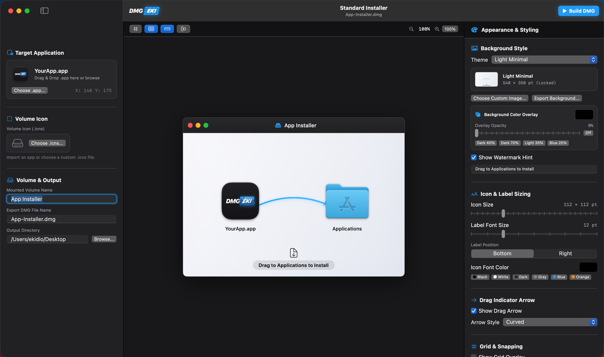
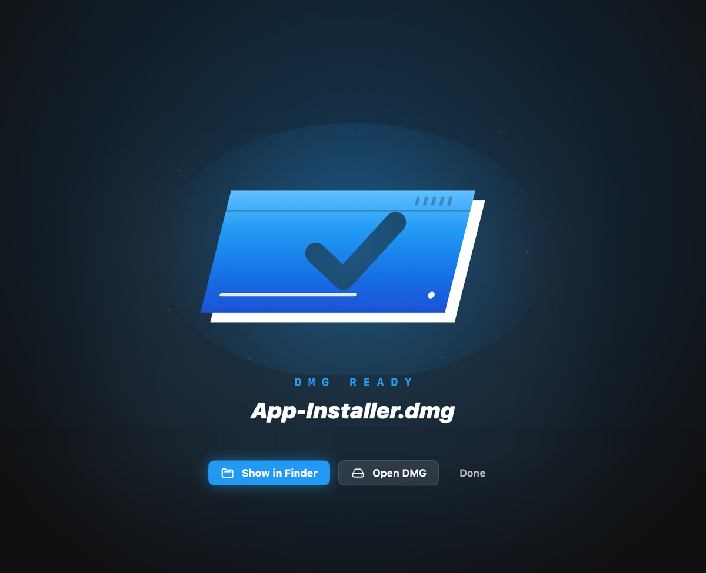

# DMGEKI – disk image · layout · build

🇬🇧 English · [🇭🇺 Magyar](README.hu.md)

**⬇ Download:** [DMGEKI.dmg (latest)](https://github.com/Ekidio/dmgeki/releases/latest/download/DMGEKI.dmg) · [release notes](https://github.com/Ekidio/dmgeki/releases/latest)



**DMGEKI** is a native macOS app for designing and building `.dmg` installers visually: drop in your app, arrange the Finder window exactly as your users will see it, style the background, and press **Build DMG**.

It's written in Swift / SwiftUI and drives the macOS command-line tools under the hood (`hdiutil`, AppleScript for the Finder window, `tiffutil`).

DMGEKI is an **EKIDIO** app. See also: [STEMEKI](https://github.com/Ekidio/stemeki) · [CHORDEKI](https://github.com/Ekidio/chordeki) · [EXEKI](https://github.com/Ekidio/exeki).

## Features

- **WYSIWYG Finder canvas:** a life-size Finder window (540 × 350 pt) with your app, the `/Applications` shortcut and their labels. Drag icons around with live X / Y readout.
- **Snapping:** grid overlay, snap to grid, snap to alignment guides, auto-centre icons vertically, zoom in / out / 100 %.
- **Background:** presets (Modern Gradient, Dark Minimal, Light Minimal, Ocean Blue) or your own image (Fill / Fit / Stretch), auto-resized to a Retina 1080 × 700 px background. Export the rendered background as an image.
- **Colour overlay:** tint the background with any colour and opacity, with quick presets.
- **Watermark hint:** an optional "Drag to Applications to Install" style hint; its text and icon follow the **Icon Font Color**.
- **Icons and labels:** icon size 64–256 pt, label size 10–18 pt, label at the bottom or on the right, label colour with swatches.
- **Drag arrow:** curved, straight, glow gradient, minimal line or none – baked into the background.
- **Files & folders:** add extra files and folders to the DMG (manuals, licences, plug-ins…) with **Add Files or Folders…** or by dragging them from Finder onto the sidebar or straight onto the canvas – they land where you drop them. Dropping a `.app` sets it as the target application. Right-click or ⌫ removes an item.
- **Volume:** mounted volume name, volume icon (your `.icns` or the app's own icon), output file name and folder.
- **Automatic updates:** DMGEKI checks GitHub for a new version at every launch (and daily while open) and offers to install it; **DMGEKI → Check for Updates…** checks right away. Updates are verified with an EdDSA signature (Sparkle).
- **Projects:** **File → Open Project…** (⌘O) and **Save Project…** (⌘S) as `.dmgproj`.
- **Build DMG** (⌘B, top right): builds the image in the background (UDZO by default; ULFO, UDBZ, UDRO, UDRW supported by the engine).
- **DMG Ready:** when the build is done, an animated card shows the file and its size, with **Show in Finder**, **Open DMG** and **Done**.
- **EKI start-up animation:** "DMG" slides in, a disc is burned track by track, the blue drive casing drops over it and locks, and "EKI" is cut out of it – with a mechanical sound (spin-up, head ticks, blocks snapping in, the latch) instead of a jingle. Click to skip.



## Requirements

- macOS 14 Sonoma or later
- Xcode command-line tools (Swift 5.9+)

## Install

Download **DMGEKI.dmg**, open it and drag DMGEKI into Applications. The app is not notarized by Apple, so the first time macOS may refuse to open it: click **Done**, then **System Settings → Privacy & Security → Open Anyway**. This is needed only once.

## Build and run

```bash
./build_app.sh
open DMGEKI.app
```

To make the installer DMG (`dist/DMGEKI-<version>.dmg`): `./make-dmg.sh`. For a release with the signed update feed (`appcast.xml`): bump the version in `Info.plist`, then `./make-release.sh`.

`build_app.sh` builds a release binary (downloading Sparkle once into `.vendor/`), packages `DMGEKI.app` with its icon and Sparkle, signs it ad-hoc and refreshes the Finder / Dock icon cache.

For development:

```bash
swift run DMGCanvasApp
```

or open `Package.swift` in Xcode and press ⌘R.

## Project layout

```
DMGEKI/
├── Package.swift
├── build_app.sh                       # release build → DMGEKI.app
├── make-dmg.sh                        # installer DMG → dist/
├── make-release.sh                    # DMG + signed Sparkle appcast for a GitHub release
├── Info.plist · release.conf · sparkle-public-key.txt
├── Tools/                             # DMG background + dmgbuild settings
├── Resources/AppIcon.icns
├── docs/assets/                       # README screenshots
└── Sources/DMGCanvasApp/
    ├── main.swift                     # app entry, menu commands (Open / Save Project)
    ├── Models/                        # project, items, window settings, formats, build log
    ├── Services/
    │   ├── DMGBuilderService.swift    # hdiutil / Finder build engine
    │   ├── CanvasBackgroundRenderer.swift
    │   ├── AppleScriptGenerator.swift
    │   ├── ImageCache.swift           # keeps images off the main thread's hot path
    │   ├── MechanicalSound.swift      # synthesised machine sounds for the animations
    │   └── …
    └── Views/
        ├── MainView.swift             # sidebar · canvas · inspector, toolbar
        ├── Canvas/ Sidebar/ Inspector/ Console/
        └── Components/
            ├── SplashView.swift       # EKI start-up animation
            ├── BuildSuccessView.swift # "DMG Ready" animation
            ├── HexColorWell.swift     # colour well bound to hex (eyedropper-safe)
            └── DMGEKILogoView.swift
```
